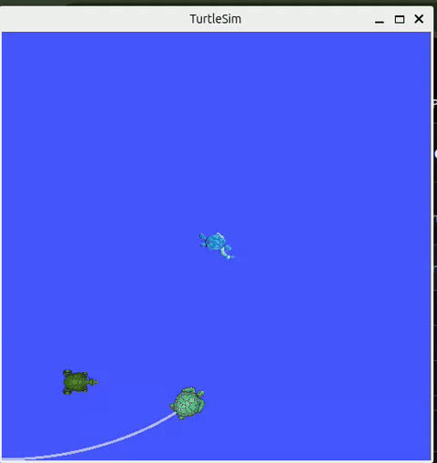

# ROS2 Mini Projects

turtlesim으로 ROS2의 핵심 통신 방식(토픽, 서비스, 액션, launch)을 하나씩 직접 구현하며 익힌 미니 프로젝트 모음입니다.
강의를 보고 단순 예제 따라하기가 아니라, 기능을 단계적으로 쌓아 마지막엔 여러 노드가 함께 도는 **추격 게임**으로 마무리했습니다.



## 구성

| 패키지                                                      | 빌드 타입    | 내용                                                       |
| ----------------------------------------------------------- | ------------ | ---------------------------------------------------------- |
| [`turtlesim_projects`](src/turtlesim_projects)             | ament_python | 토픽·서비스·launch 실습 8단계 (도형 그리기 → 추격 게임) |
| [`turtle_action_interfaces`](src/turtle_action_interfaces) | ament_cmake  | 커스텀 액션 타입 `MoveToGoal` 정의                       |
| [`turtle_action_practice`](src/turtle_action_practice)     | ament_python | `MoveToGoal` 액션 서버 / 클라이언트                      |

### turtlesim_projects: 단계별 진행

| #  | 노드                       | 다룬 개념                                         |
| -- | -------------------------- | ------------------------------------------------- |
| 1a | `draw_shape_time`        | 타이머, 시간 기반 개루프 제어                     |
| 1b | `draw_shape_pose`        | pose 구독 기반 폐루프 제어                        |
| 2  | `custom_teleop`          | 키보드 입력 → `cmd_vel` 발행                   |
| 3  | `turtle_chase`           | `/spawn` 서비스, 두 거북이 pose 구독, 추격 제어 |
| 4  | `turtle_service_control` | spawn / kill / set_pen / reset 서비스 호출        |
| 5  | `waypoint_nav`           | 경로점 순차 추종                                  |
| 6  | `obstacle_avoid`         | potential field 기반 장애물 회피 추격             |
| 7  | `game_referee`           | 잡기 판정, 점수, 리스폰                           |
| 8  | `game.launch.py`         | 여러 노드를 launch 파일로 한 번에 실행            |

각 단계의 설계와 시행착오는 [`docs/`](src/turtlesim_projects/docs) 폴더에 정리했습니다.

### turtle_action_practice: 액션 통신

- 클라이언트가 목표 좌표 `(x, y)`를 보내면, 서버가 거북이를 이동시키며 남은 거리를 feedback으로 보고하고, 도착 시 성공 여부와 소요 시간을 result로 반환
- 이동 중 취소(cancel) 요청 처리
- `MultiThreadedExecutor` + `ReentrantCallbackGroup`으로, 액션 실행 중에도 pose 구독과 취소 콜백이 막히지 않도록 구성

## 배운 점

- 콜백이 반환하지 않으면 노드 전체가 멈춘다.
  - 액션 서버의 `execute_callback` 안에서 while로 이동시켰더니, 거북이는 화면에서 움직이는데 서버가 계산한 남은 거리는 계속 같은 값이었다. 단일 스레드 executor가 그 콜백에 붙잡혀 pose 구독 콜백을 실행하지 못해서, 위치가 초기값에 고정돼 있었다. 취소 요청도 같은 이유로 처리되지 않았다. `MultiThreadedExecutor`로 스레드를 늘리고, 구독과 액션 서버를 같은 `ReentrantCallbackGroup`에 넣어 해결했다. Nav2 같은 실제 액션 서버도 같은 패턴을 쓴다.
- 시간으로 추정한 위치는 틀린다
  - 속도 × 시간으로 사각형을 그렸더니 회전각이 정확히 90도씩 쌓이지 않아 도형이 닫히지 않았다. `/pose`를 구독하는 폐루프로 바꿔도, 0.1초마다만 도착을 확인하니 매번 조금씩 더 도는 오버슈트가 남았다. 남은 각도에 비례해 속도를 줄이는 P 제어와 허용오차로 해결했고, 정착 시간 공식으로 gain 값을 계산해 정했다.
- 도착 판정 임계값은 한 번에 움직이는 거리보다 커야 한다
  - 웨이포인트 주행에서 거북이가 목표를 지나쳤다가 되돌아오기를 반복하며 주변을 맴돌았다. 한 tick에 약 0.1만큼 움직이는데 임계값을 0.05로 잡아 반경 안에 들어오는 순간을 놓친 것이다. 임계값을 키우는 대신, 가까워질수록 느려지도록 거리에 비례한 속도와 상한을 줬다.

## 실행 환경

- Ubuntu 24.04, ROS2 Jazzy
- Python 3, rclpy, turtlesim

## 빌드 & 실행

```bash
cd ~/ros2/ros2_portfolio/mini_project
colcon build
source install/setup.bash
```

**추격 게임 (launch)**

```bash
ros2 launch turtlesim_projects game.launch.py
# 키보드 조종은 별도 터미널에서 (launch에서는 표준입력을 못 받음)
ros2 run turtlesim_projects custom_teleop
```

**개별 노드**

```bash
ros2 run turtlesim turtlesim_node              # 터미널 1
ros2 run turtlesim_projects draw_shape_pose    # 터미널 2
```

**액션 서버 / 클라이언트**

```bash
ros2 run turtlesim turtlesim_node              # 터미널 1
ros2 run turtle_action_practice goal_server    # 터미널 2
ros2 run turtle_action_practice goal_client    # 터미널 3
```
